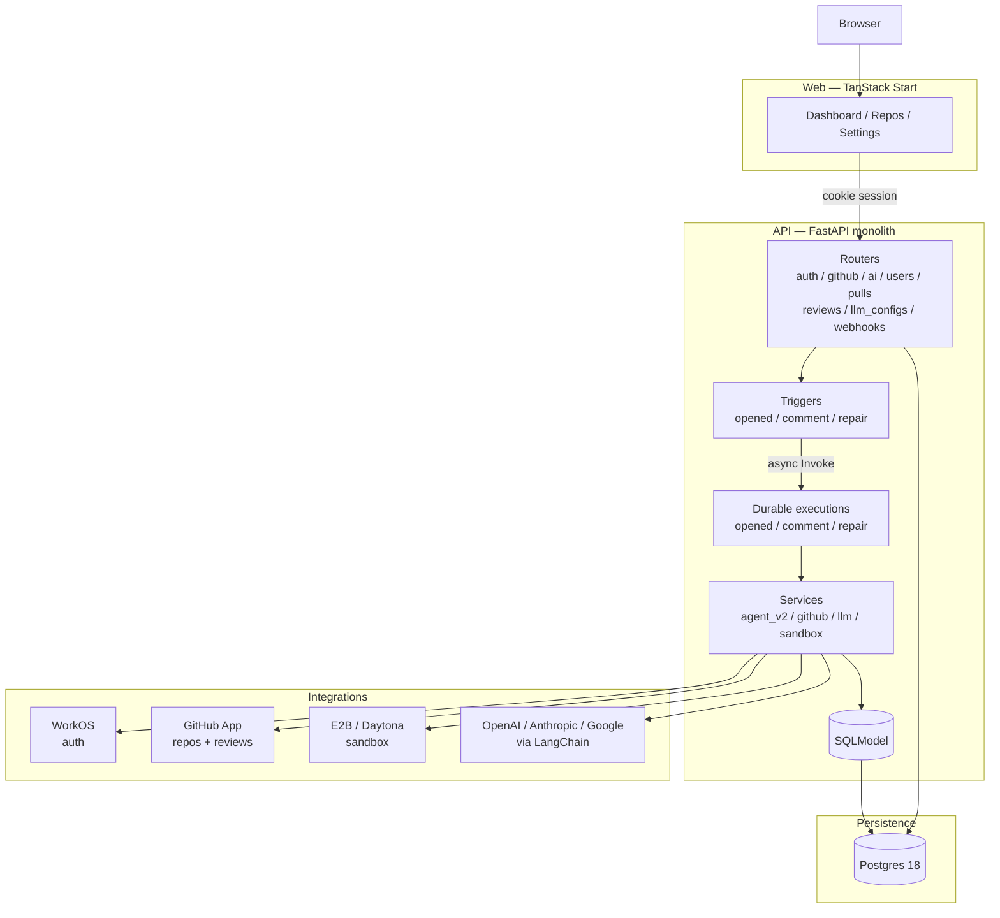
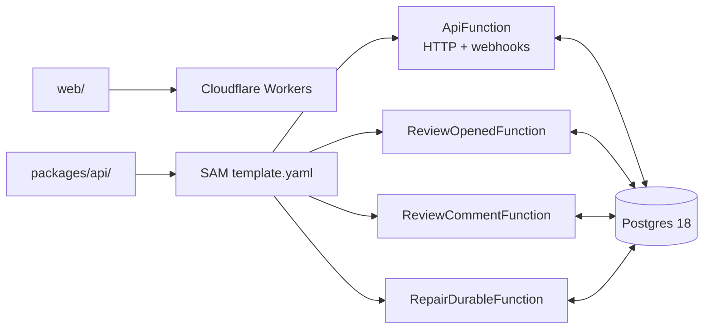
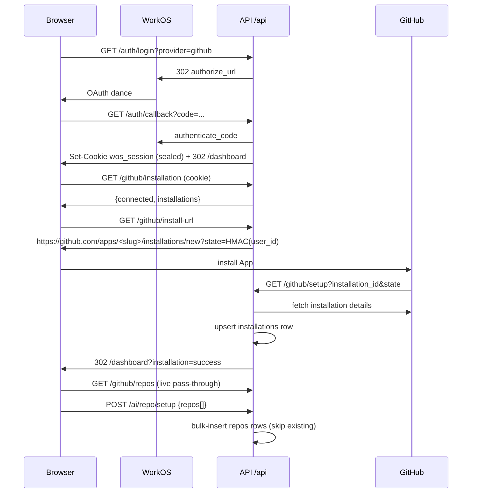
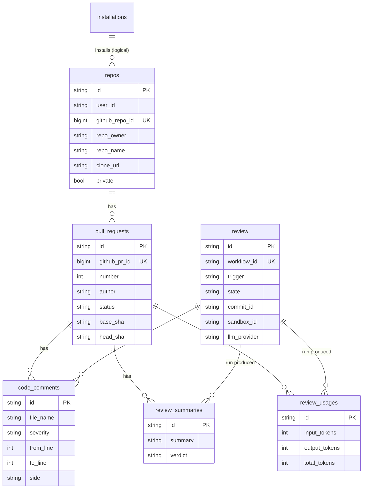

# Sentinel — High-Level Architecture

> AI-powered GitHub pull-request reviewer. Reads a diff, posts inline comments tagged by severity (`P1_CRITICAL` / `P2_WARNING` / `P3_NITPICK`), and publishes a short summary with verdict (`APPROVE` / `COMMENT` / `REQUEST_CHANGES`).
>
> Audience: new contributors, reviewers, demo walkthrough.
> Depth: high-level. For run commands see `README.md`. For present-tense deep reference see `AGENTS.md`.

---

## 1. System in one picture

Three planes, one database. Web owns UX, API owns state + pipelines, Integrations own identity / code / compute / LLM.



Deploy shape:



| Plane | Code | Runs on | Owns |
|---|---|---|---|
| Web | `web/` | Cloudflare Workers | sign-in, install, repo select, LLM config |
| API | `packages/api/` | AWS Lambda (4 fns) + local uvicorn | auth, GitHub App client, sandbox abstraction, durable pipelines |
| Integrations | SDKs | WorkOS / GitHub / E2B / LLM providers | identity, repo access, compute, models |
| DB | `alembic/versions/` | Postgres 18 (`docker-compose.yml`) | 9 tables, CASCADE deletes |

---

## 2. Monorepo tree

```
ai-code-review/
├── pyproject.toml            # uv workspace root, Python 3.13
├── docker-compose.yml        # Postgres 18
├── .env / .env.example       # backend env (repo root, not packages/api/.env)
├── README.md                 # quickstart + API surface
├── AGENTS.md                 # deep present-tense reference
├── ARCHITECTURE.md           # this file — high-level with diagrams
├── packages/
│   ├── api/                  # FastAPI backend
│   │   ├── main.py           # create_app(), lifespan, Mangum handler
│   │   ├── template.yaml     # SAM: Api + 3 durable Lambdas + HttpApi
│   │   ├── alembic/          # versions/ forward-only migrations
│   │   └── src/app/
│   │       ├── core/         # config, db, auth, middleware, workos, telemetry
│   │       ├── models/       # SQLModel tables + enums
│   │       ├── repositories/ # BaseRepository[T] + subclasses
│   │       ├── routers/      # health, auth, github, ai, users, pulls,
│   │       │                #   reviews, llm_configs, webhooks (+ schemas/)
│   │       ├── services/     # agent_v2, github/, llm/, sandbox/
│   │       ├── workflows/    # triggers/, durable/, review_v2/
│   │       └── utils/        # branded ids, sandbox paths, agent schemas
│   ├── codegraph/            # codegraph CLI (pip: sentinel-codegraph)
│   └── evals/                # quality harness: dataset + review + judge
└── web/                      # TanStack Start frontend (pnpm)
    ├── wrangler.jsonc
    ├── src/
    │   ├── router.tsx / routeTree.gen.ts
    │   ├── routes/           # /, /login, /dashboard(/repositories|settings)
    │   ├── components/       # layout + shadcn/ui primitives
    │   └── lib/              # api.ts, auth.ts, installation.ts, repos.ts,
                              #   llm.ts, stats.ts, pulls.ts, nav.tsx
```

Tooling: `uv` (Python), `pnpm` (web), `pyright` (root), `tsc` via Vite, Alembic (schema). Env: API reads repo-root `.env`, web reads `web/.env` (`VITE_API_URL` includes `/api` prefix).

Backend entry: `packages/api/main.py:create_app()` — `CORSMiddleware` → `AuthMiddleware` → 9 routers under `settings.api_prefix` → `instrument_fastapi`. `lifespan` runs `create_all` for greenfield dev only.

Frontend entry: `web/src/routes/__root.tsx` — single `QueryClient`, `QueryClientProvider`, `Toaster`. All server state via TanStack Query, no `useEffect` fetching. Every call sends `credentials: include`.

---

## 3. Two flows that explain everything

### 3.1 Onboarding: sign-in → install → configure



Key files:

- Web: `web/src/lib/api.ts`, `auth.ts`, `installation.ts`, `repos.ts`
- API: `src/app/routers/auth.py`, `routers/github.py`, `routers/ai.py`
- Auth edge: `src/app/core/middleware.py` (`PROTECTED_PREFIXES`, `BYPASS_PREFIXES`), `core/workos.py` (local Fernet seal/unseal, no IO on hot path)

Notes:

- Protected prefixes: `/api/github`, `/api/ai`, `/api/users`, `/api/llm_config`, `/api/review`, `/api/pulls`. Bypass: `/api/github/setup` (no cookie on GitHub redirect), `POST /api/review` (gated by `X-Eval-Token`).
- Install state is HMAC-signed (`GITHUB_INSTALL_STATE_SECRET` fallback `WORKOS_COOKIE_PASSWORD`).
- Setup callback is source of truth; `installation.created` webhook is no-op.

### 3.2 Review: webhook → durable execution → inline post

```mermaid
sequenceDiagram
  participant G as GitHub
  participant W as POST /webhooks/github
  participant T as triggers/invoke
  participant D as durable handler
  participant S as sandbox (E2B)
  participant L as LLM agents
  participant P as Postgres
  participant GR as GitHub reviews API

  G->>W: pull_request opened / issue_comment created
  W->>W: verify X-Hub-Signature-256
  W->>T: handlePullRequestOpened / handleIssueCommentCreated
  T->>D: async Invoke (deterministic name)
  D->>P: resolve ctx (user/repo/PR/last-review/LLM+sandbox)
  D->>S: createEphemeralSandbox
  D->>S: clone @ head SHA (fail-closed) + codegraph index
  D->>S: git diff base...head → split_diff.py → splitted_diffs/
  D->>L: planner (search_codegraph) → plan.json
  D->>L: per-file agents (batched, each retries alone)
  D->>P: persist summary + comments + usage (with review_id)
  D->>GR: post inline review (own retry; terminal 4xx → posted=false)
  D->>P: mark review SUCCESS + backlinks (github_review_id)
  D->>S: destroySandbox (best-effort)
```

Execution names (idempotent, encode domain):

- opened: `review-v2:{gh_repo}:{pr}:{head_sha[:7]}`
- comment re-review: `review-v2:{gh_repo}:{pr}:{delivery}` (head unknown without fetch)
- repair: `repair:{pr}:{head_sha[:7]}`

Comment trigger (`issue_comment.created` mentioning `@<app_slug> review`) runs incremental re-review: `diffBaseSha = last reviewed head`, so only new commits are diffed. `baseSha` on rows stays the PR's true base.

Repair: when inline post returns `posted=false` (terminal 422, e.g. bad anchor), `triggerRepairAfterReview` dispatches repair durable best-effort. Repair re-anchors saved drafts and publishes; never re-runs the review LLM.

---

## 4. Review pipeline internals

Shared runner: `workflows/durable/pipeline.py:runAgentPhase`. Steps live in `workflows/durable/steps/` (each `@durable_callable`, input = validated Pydantic model, output = `model_dump`). Retries via `durable/retry.py` (`RETRY_3` infra/persist, `RETRY_1` degrade/batch).

```
resolve
├── createEphemeralSandbox   # fresh per run, only id travels onward
├── upsertPrRow
└── markReviewRunning        # find-or-create by workflow_id (unique index)

build world (fail-closed past clone)
├── clonePrHead              # default-branch clone + PR-ref fetch + detached head
├── indexCodegraph           # pip install sentinel-codegraph + index --overwrite
├── fetchPrDiff              # git diff {diffBaseSha or baseSha}...head → file.diff
├── splitPrDiff              # upload + run split_diff.py → overview.md + chunks
└── listDiffChunks           # inventory splitted_diffs/ → ChunkInventory truth

agents
├── runPlanner + readPlannerOutput   # enrichment-only, failure → empty context
├── buildFileReviewJobs (pure)       # join inventory (truth) + planner (enrichment)
├── runFileBatch                     # one lane per file, sequential batches,
│                                    # each lane retries alone, failed lane → nothing
├── extractReviewComments            # structured extractor → CodeComment drafts
└── synthesizeWalkthrough            # summary markdown, degrades to empty

finish
├── persistSummary + persistComments + persistUsage
├── postGithubReview                 # 429/5xx retried, terminal 4xx → posted=false
│   └── dispatchRepairFollowUp (best-effort if posted=false with comments)
├── markReviewSucceeded
└── destroySandbox (never masks outcome)
except: markReviewFailed + destroySandbox → ReviewFailed
```

Diff → anchor contract (why 422s don't happen):

1. `scripts/split_diff.py` (stdlib-only, uploaded as bytes) writes per-file chunks with visible `LEFT`/`RIGHT` gutter numbers into `splitted_diffs/`. Agents anchor only to lines they see.
2. `convertToGithubComments` / `toGithubComments` reject `from_line < 1` as final guard.

Agent layout (`services/agent_v2/`):

```
agent_v2/
├── types.py          # AgentV2Ctx (live deps, never crosses durable boundary)
│                     # PlannerContext / FileContext / ChunkInventory / FileReviewJob
├── service.py        # ctx factory + agent builders + submit_plan + search_codegraph
├── prompts/
│   ├── planning.py   # research rubric + submit_plan contract
│   ├── file_review.py# single-chunk review rubric
│   ├── summary.py    # walkthrough synthesis
│   └── shared.py     # comment contract, NO_FINDINGS, PR-intent, getReviewDiffDirPath
├── _middleware.py    # NoDelegationMiddleware (strips task tool) + retry/limits
└── errors.py         # AgentV2BuildError as value, never raised
```

- Planner gets `submit_plan` + `search_codegraph`. File agents get `search_codegraph` only.
- Full query ladder over the run's codegraph DB, closed over ctx.
- Verdict is deterministic in code (`steps/combine.py:verdictFor`): any P1 → `REQUEST_CHANGES`, else P2/P3 → `COMMENT`, else `APPROVE`.

---

## 5. Data model (9 tables)

Postgres 18 is the only persistence tier. UUID string PKs, `timestamptz` with `now()` defaults, CASCADE at DB layer with `passive_deletes=True`.



- `review` = per-run lifecycle row keyed by deterministic `workflow_id`. Carries `commit_id` (head), `sandbox_id`, LLM snapshot (`llm_provider` = `system`|`user`, `llm_client`, `llm_model`).
- `code_comments.commit_id` / `review_summaries.commit_id` are plain head-SHA strings, no FK.
- `sandboxes` table is legacy/unreferenced — runs use ephemeral sandboxes recorded only as `review.sandbox_id`.
- `llm_configs` = per-user provider/model/base_url/api_key (redacted at router).
- Enums: `PRStatus`, `CommentSeverity`, `CommentSide`, `CommentState`, `ReviewVerdict`, `SandboxState`, `ReviewRunStatus`.

---

## 6. Service pattern (github / llm / sandbox)

Shared contract in `AGENTS.md §9`. One domain per package under `services/<name>/`:

```
services/<name>/
├── types.py     # ctx (identity + injected dep) + results, branded ids
├── errors.py    # BaseModel errors as values, never raised
├── service.py   # camelCase entry points, (ctx, ...) -> value | error
├── _client.py   # (optional) process-wide provider client factory
└── <sub>/       # e.g. github/installation|repo|pr|webhook
```

Rules:

- Env validated at startup — services never gate on `*_configured`.
- Identity validated upstream — ctx constructors are plain.
- No `logging` in services — return values, log at edge (routers/steps).
- Errors are values (`T | ErrorType`, discriminate with `isinstance`). Raise only for programmer/config bugs.
- Deps live on ctx (`InstallationCtx`/`RepoCtx`/`PRCtx` carry the githubkit client, `arbitrary_types_allowed`). Exception: ctxs crossing durable boundary (`SandboxCtx`, `LLMCtx`) stay pure serializable data.
- DB sessions owned by caller (`listInstallations(session, ctx)`).
- LLM: `LLMCtx` (frozen) resolved per-user (`resolveActiveLlmCtx` → `createDefaultLLMContext` fallback), consumed only via `createLLMModel`.
- Sandbox: provider map in `services/sandbox/service.py` is the only place importing E2B/Daytona adapters.

---

## 7. Config + observability

`Settings` (`core/config.py`) loaded from repo-root `.env` is the single env source. Routes 503 when dep missing; webhook receiver 401s all deliveries when `GITHUB_WEBHOOK_SECRET` unset.

| Group | Keys | Notes |
|---|---|---|
| Server | `DATABASE_URL`, `CORS_ORIGINS`, `API_PREFIX` | asyncpg URL, JSON-array origins |
| WorkOS | `WORKOS_API_KEY/CLIENT_ID/REDIRECT_URI/COOKIE_PASSWORD`, `FRONTEND_URL` | cookie `secure=True` hard-coded |
| Sandbox | `SANDBOX_PROVIDER`, `E2B_*`, `DAYTONA_*` | `e2b` or `daytona` |
| LLM | `LLM_MODEL` (`provider:model`), `LLM_API_KEY/BASE_URL/HEADERS`, `LLM_MAX_RETRIES/RATE_LIMIT` | falls back to `OPENAI_API_KEY` etc. via provider map |
| GitHub App | `GITHUB_APP_ID/CLIENT_ID/SECRET/SLUG/PRIVATE_KEY`, `GITHUB_WEBHOOK_SECRET`, `GITHUB_INSTALL_STATE_SECRET` | state secret falls back to cookie password |
| Durable | `REVIEW_OPENED/COMMENT_FUNCTION_NAME`, `REPAIR_DURABLE_FUNCTION_NAME` | Invoke targets |
| Telemetry | `TRACELOOP_BASE_URL/API_KEY/TRACE_CONTENT/DISABLE_BATCH`, `TELEMETRY_FASTAPI` | both empty → SDK never init |

Telemetry (`core/telemetry.py`, OpenLLMetry `traceloop-sdk`): traces via LangChain auto-instrumentation (`gen_ai` spans with model/tokens/latency) + FastAPI instrumentor; logs via OTel SDK `LoggingHandler` on root logger to `<endpoint>/v1/logs`. Failures log full run context (PR, SHAs, user, LLM, workflow id) as stdlib log records.

---

## 8. Where to find things

| Concern | Path |
|---|---|
| App entry | `packages/api/main.py` |
| Settings/env | `packages/api/src/app/core/config.py` |
| Auth/middleware | `core/auth.py`, `core/middleware.py`, `core/workos.py` |
| Routers | `src/app/routers/` (`auth`, `github`, `ai`, `users`, `pulls`, `reviews`, `llm_configs`, `webhooks`) |
| Router schemas | `src/app/routers/schemas/` |
| ORM + enums | `src/app/models/` |
| Migrations | `packages/api/alembic/versions/` |
| GitHub services | `src/app/services/github/{installation,repo,pr,webhook}/` |
| Sandbox | `src/app/services/sandbox/` |
| LLM factory | `src/app/services/llm/` (`LLMCtx` + `createLLMModel`) |
| Per-user LLM config | `src/app/services/llm/config/` + `routers/llm_configs.py` |
| Agent prompts | `src/app/services/agent_v2/prompts/` |
| Agent schemas | `src/app/utils/schema.py` (`CodeCommentDraft`, `ReviewComments`, `ReviewResult`) |
| Triggers | `src/app/workflows/triggers/{invoke,opened_payload,comment_payload,repair}.py` |
| Durable handlers | `src/app/workflows/durable/{opened_handler,comment_handler,repair_handler}.py` |
| Shared phases | `workflows/durable/{pipeline,repair_pipeline}.py` + `steps/` + `naming.py` + `retry.py` |
| Review workers | `src/app/workflows/review_v2/steps/` |
| Split script | `src/app/workflows/review_v2/scripts/split_diff.py` |
| GitHub post | `workflows/review_v2/steps/post_review.py` |
| Evals harness | `packages/evals/` (`main.py`, `dataset/`, `agents/review|judge/`, `report/`) |
| Web pages | `web/src/routes/` |
| Web client/hooks | `web/src/lib/{api,auth,installation,repos,llm,stats,pulls}.ts` |
| Deploy | `packages/api/template.yaml`, `web/wrangler.jsonc`, `docker-compose.yml` |

Related docs: `README.md` (run + API surface), `AGENTS.md` (deep reference), per-dir `README.md` files under `src/app/`.
